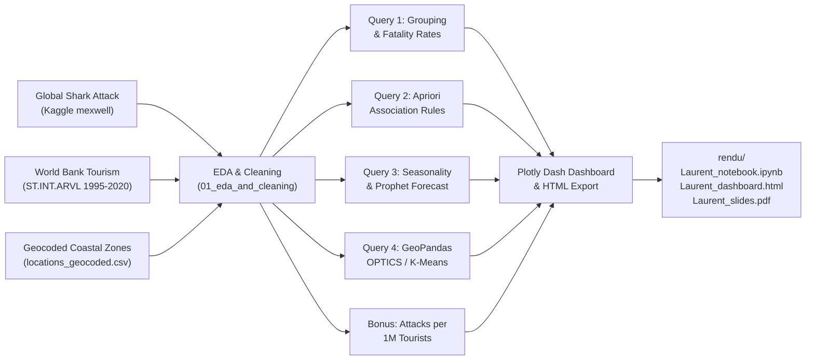

# Programming for Data Science — Global Shark Attacks & International Tourism Analysis

<p align="center">
  
  
  
  
  
</p>

---

## Executive Overview

Repository for the **Programming for Data Science** final project taught by **Hugo Alatrista-Salas** at **ESILV (Ecole Superieure d'Ingenieurs Leonard de Vinci — A4 DIA3)**.

The objective is to apply the complete **Knowledge Discovery in Databases (KDD)** pipeline to a real **multidimensional dataset** combining **Temporal**, **Spatial**, and **Analytical** dimensions, enriched with an external macroeconomic dataset (`+1 bonus point`), and present all extracted indicators inside an interactive **Python Dash** visualization prototype.

### Selected Datasets (Local Only — Not Tracked by Git)

| Role | Dataset Title | Official Source | Shared Dimensions |
| --- | --- | --- | --- |
| **Primary Dataset** | Global Shark Attack (GSAF) | [Kaggle (`mexwell/global-shark-attack`)](https://www.kaggle.com/datasets/mexwell/global-shark-attack) | Temporal (`Date`, `Year`, `Time`), Spatial (`Country`, `Area`, `Location` + geocoded `lat/lon`), Analytical (`Type`, `Activity`, `Species`, `Fatal`) |
| **External Bonus (+1 pt)** | International tourism, number of arrivals (`ST.INT.ARVL`) | [World Bank Indicator `ST.INT.ARVL`](https://data.worldbank.org/indicator/ST.INT.ARVL) | Country-year arrivals (266 countries/regions, 1995-2020) joined on `(Country, Year)` |

> [!IMPORTANT]
> Datasets are stored **locally** by each team member inside `projet/data/` and excluded via `.gitignore`. See [`doc/DATA_SETUP.md`](doc/DATA_SETUP.md) for step-by-step installation instructions.

---

## Team & Ownership

| Member | GitHub | Primary Responsibilities |
| --- | --- | --- |
| **Maxime Laurent** (Team Leader) | [@maximelrnt](https://github.com/maximelrnt) | Deliverable coordination (`Laurent_*`), EDA, data cleaning, country normalization, and final notebook assembly |
| **Louis Le Forestier** | [@louislefo](https://github.com/louislefo) | Repository architecture, Query 4 (Spatial Clustering with `GeoPandas` / `OPTICS` / `K-Means`), and Dash dashboard |
| **Baptiste Noailhac** | [@BaptisteNoai](https://github.com/BaptisteNoai) | Query 1 (Grouping & fatality rates) and Query 2 (Frequent Pattern Mining with `mlxtend` / `Apriori`) |
| **Romain Thepaut** | [@RomThpt](https://github.com/RomThpt) | Query 3 (Temporal seasonality & `Prophet` forecasting) and External Bonus Dataset (World Bank Tourism risk rate) |

---

## Project Pipeline



---

## Repository Architecture

```text
programming-for-data-science/
├── .gitignore                              # Excludes local datasets, .venv, and caches
├── README.md                               # Main repository presentation & entry points
├── REQUIREMENTS.md                         # Environment setup & troubleshooting guide
├── requirements.txt                        # Exact pip dependencies
│
├── doc/                                    # Project documentation
│   ├── PROJECT_OVERVIEW.md                 # Objectives, rubric (20 + 1 pts), anti-penalty checklist
│   ├── DATA_SETUP.md                       # Local dataset download & placement instructions
│   ├── INDICATORS_SPEC.md                  # Technical spec of the 4 queries + Tourism Bonus + Dash
│   └── TEAM_WORKFLOW.md                    # Role split, Git branching, and code conventions
│
├── projet/                                 # Development workspace
│   ├── Final_project.pdf                   # Official ESILV project instructions
│   ├── README.md                           # Workspace guide
│   ├── data/                               # LOCAL ONLY datasets (see doc/DATA_SETUP.md)
│   │   ├── .gitkeep
│   │   └── README.md
│   ├── notebooks/                          # Completed and executed working notebooks
│   │   ├── 01_eda_and_cleaning.ipynb
│   │   ├── 02_grouping_and_apriori.ipynb
│   │   ├── 03_temporal_forecasting.ipynb
│   │   ├── 04_spatial_clustering.ipynb
│   │   └── 05_tourism_bonus.ipynb
│   ├── src/                                # Shared modular Python functions
│   │   ├── __init__.py
│   │   ├── data_loader.py
│   │   ├── indicators.py
│   │   └── dashboard.py
│   └── slides/
│       └── README.md                       # 5-minute oral defense structure
│
└── rendu/                                  # Final DVLC submission deliverables
    ├── README.md                           # Naming conventions & pre-submission checklist
    └── Laurent_notebook.ipynb              # 100% self-contained master deliverable notebook (all functions + __main__, executed)
```

---

## Quickstart

1. **Set up your Python environment:** Follow [`REQUIREMENTS.md`](REQUIREMENTS.md) (`python -m venv .venv` then `pip install -r requirements.txt`).
2. **Download the two datasets locally:** Follow [`doc/DATA_SETUP.md`](doc/DATA_SETUP.md) to populate `projet/data/`.
3. **Check your assigned tasks & specs:** Read [`doc/TEAM_WORKFLOW.md`](doc/TEAM_WORKFLOW.md) and [`doc/INDICATORS_SPEC.md`](doc/INDICATORS_SPEC.md).
4. **Work in your assigned `projet/notebooks/*.ipynb` and `projet/src/*.py`**, then consolidate into [`rendu/Laurent_notebook.ipynb`](rendu/Laurent_notebook.ipynb).
